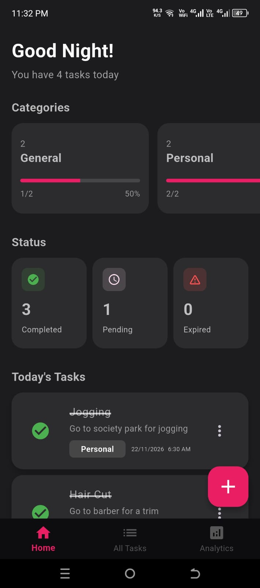
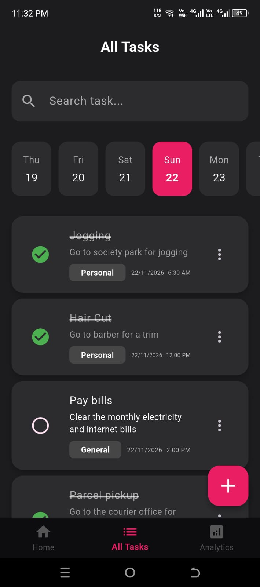
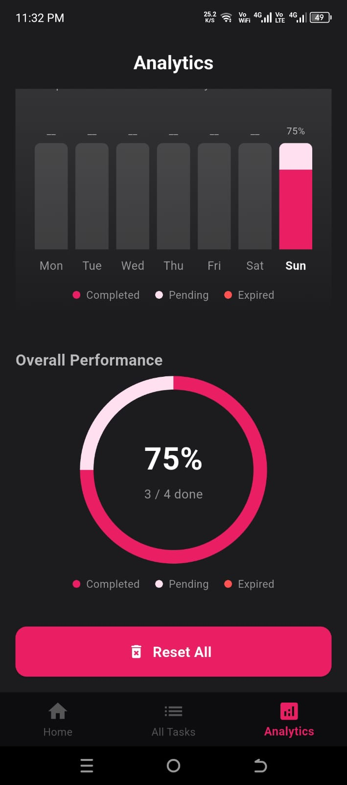
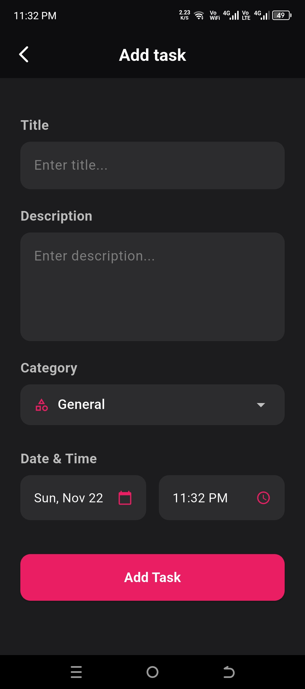
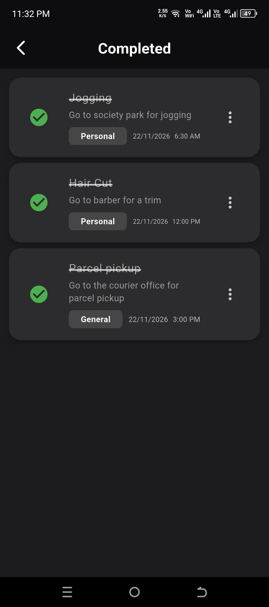
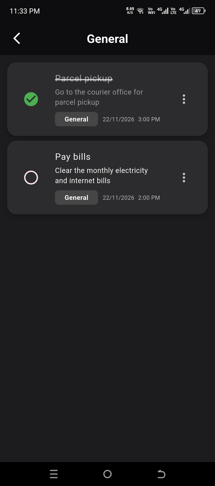
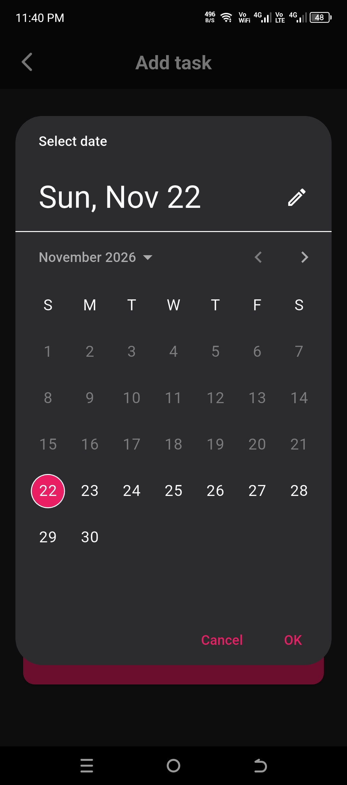
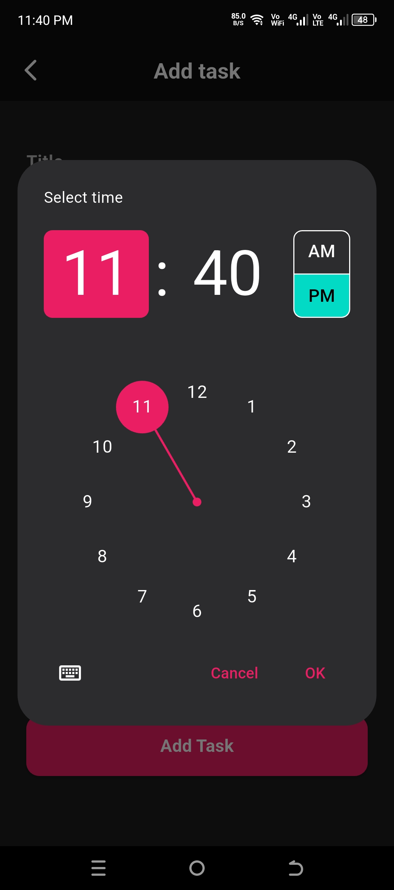

# Flutter Task Management App with Riverpod

A modern and responsive Task Management application built using **Flutter and Riverpod**, focusing on clean architecture, efficient state management, optimized widget rebuilds, and immutable state handling.

This project demonstrates practical knowledge of Riverpod and its application in building maintainable, scalable, and performance-conscious Flutter applications.

## 📱 Screenshots

| Home Screen | All Tasks |
|---|---|
|  |  |

| Analytics | Add Task |
|---|---|
|  |  |

| Completed Tasks | Category Filter |
|---|---|
|  |  |

| Date Picker | Time Picker |
|---|---|
|  |  |

## ✨ Features

### Task Management
- Organize tasks into different categories.
- Filter tasks by their status.
- Search tasks using a dedicated search provider.
- Mark tasks as completed.
- View tasks based on selected dates.
- Add tasks with title and description.

### Dashboard & Analytics
- Dedicated Home, All Tasks, and Analytics screens.
- Category-wise task progress.
- Completed, Pending, and Expired task statistics.
- Day-wise task analytics.
- Overall task completion performance.
- Visual representation of task statistics.

### Date & Time Management
- Integrated date picker.
- Integrated time picker.
- Date-based task organization.

### State Management & Architecture
- Riverpod for application state management.
- Consumer widgets for efficient state consumption.
- Select method for minimizing unnecessary widget rebuilds.
- Immutable state management using the `copyWith` method.
- Clean Architecture principles.
- Reusable widgets and organized code structure.

### UI & UX
- Modern dark Material theme.
- Custom pink accent color.
- Responsive task cards.
- Bottom navigation bar.
- Clean and intuitive user interface.
- Reusable UI components.

## 🛠️ Tech Stack

| Technology | Purpose |
|---|---|
| Flutter | Cross-platform UI development |
| Dart | Programming language |
| Riverpod | State management |
| Consumer | Reactive widget updates |
| Select | Optimized widget rebuilds |
| Clean Architecture | Code organization |
| Material Design | UI components and theming |

## 🧠 Key Learning Outcomes

This project was developed to strengthen practical understanding of:

- Managing application state using Riverpod.
- Understanding reactive state updates.
- Optimizing widget rebuilds using `Consumer` and `select`.
- Implementing immutable state with `copyWith`.
- Separating application responsibilities using Clean Architecture.
- Creating reusable and maintainable Flutter widgets.
- Building data-driven dashboards and analytics interfaces.

## 🚀 Getting Started

### Prerequisites

- Flutter SDK
- Dart SDK
- Android Studio or VS Code
- Flutter-compatible emulator or physical device

### Installation

1. Clone the repository:

   ```bash
   git clone <your-repository-url>
   ```

2. Navigate to the project directory:

   ```bash
   cd flutter_task_management
   ```

3. Install dependencies:

   ```bash
   flutter pub get
   ```

4. Run the application:

   ```bash
   flutter run
   ```

## 📂 Architecture

The project follows Clean Architecture principles to maintain separation of concerns and improve code maintainability.

The application is organized around three main architectural responsibilities:

- **Presentation:** UI screens, reusable widgets, and state consumption.
- **Domain:** Application business logic and core functionality.
- **Data:** Data handling and repository responsibilities.

## 🎯 Project Purpose

The primary objective of this project is to demonstrate practical Flutter development skills, particularly:

- Riverpod state management.
- Efficient and optimized widget rebuilds.
- Clean Architecture.
- Immutable state handling.
- Modern Flutter UI development.

Rather than focusing on a large number of features, this project emphasizes code organization, state management practices, and UI quality.

## 👨‍💻 Developer

Developed as a Flutter learning and portfolio project to demonstrate practical implementation of Riverpod state management and Clean Architecture.

---

**Built with Flutter & Riverpod ❤️**
